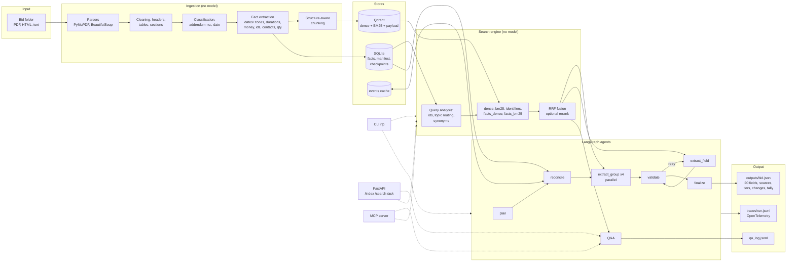
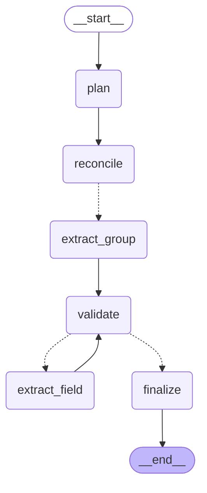

# Architecture

Two deterministic layers (ingestion and the fact layer, then the hybrid index) do as much of
the work as possible without a model. The agents on top choose among typed candidates and
cited passages, and everything they produce is checked by code before it is written out.

## System

## Agent graph

Generated from the compiled graph with `uv run rfp diagram` (source in
[agent_graph.mmd](agent_graph.mmd)). Dotted edges are conditional: `reconcile` fans out one
`extract_group` per field group with `Send`; `validate` routes each failed field to
`extract_field` (up to two retries) or everything to `finalize`.

## One extraction run, step by step

1. **plan** reads the manifest. If the bid is not indexed it indexes it (parse, facts,
   chunks, embeddings). It lists the documents with type, addendum number and date, and sets
   the plan: the four field groups.
2. **reconcile** loads the bid's facts. Deadline and pre-bid facts inside addenda become
   `replace` events. For each addendum, one structured model call lists the other changes
   (new requirements, amendments, clarifications); events whose quote is not verbatim
   addendum text are dropped; the result is cached per document. The date fields are then
   resolved by folding the events over the base documents, with the portal page used to fill a
   missing time and to corroborate. Resolved fields skip the model entirely.
3. **extract_group** (four in parallel): for each field, gather evidence (hybrid search for
   the field's queries plus every chunk holding a labelled fact), then one structured call
   returns a draft per field: status, value, verbatim quotes with passage ids, notes.
4. **validate**: every quote must be a substring of its passage; the value must follow from
   the quotes by field type; "not found" needs at least three searches and no labelled facts.
   A failure carries a reason.
5. **extract_field**: a failed field is retried alone, with the reason in the prompt and the
   slower reranked retrieval. At most two retries per field.
6. **finalize**: text events are applied to the reconcilable fields, each field gets its
   confidence tier from the decision table, the summary is generated from the field values
   and checked for sentence count and invented numbers, and the JSON is written with the
   change log, validation tally and token cost.

Every node is a span under the run's root span; the span file is rendered with
`uv run rfp trace <run_id>`.

## Where the brief's requirements live

| Requirement | Where |
|---|---|
| Parsing, cleaning, metadata, failure log | `ingestion/` |
| Chunking with structure and overlap | `search/chunking.py` |
| Embeddings, vector store with metadata | `search/embed.py`, `search/backend.py` |
| Incremental indexing | `search/manifest.py`, `search/indexer.py` |
| Hybrid retrieval, filters, rerank, query rewriting | `search/engine.py`, `search/query.py`, `config/synonyms.yaml` |
| Retrieval eval, two or more configurations | `eval/retrieval_gold.yaml`, `eval/retrieval.py`, `docs/eval/retrieval.md` |
| REST API and CLI | `api/app.py`, `cli.py` |
| Agent roles, shared state, feedback loop, parallelism | `agents/graph.py` |
| Structured agent messages | `agents/outputs.py`, `agents/schema.py` |
| Addendum reconciliation | `agents/reconcile.py`, `agents/addenda.py` |
| Guardrails: citations, not found | `agents/validate.py`, `agents/qa.py` |
| Observability | `telemetry.py`, `trace_render.py` |
| Error handling | `agents/llm.py` (retries, refusals, truncation), `ingestion/loader.py` |
| 20 fields with sources, confidence, notes | `config/fields.yaml`, `agents/confidence.py`, `agents/schema.py` |
| Extraction accuracy and calibration | `eval/extraction_gold.yaml`, `eval/extraction.py` |
