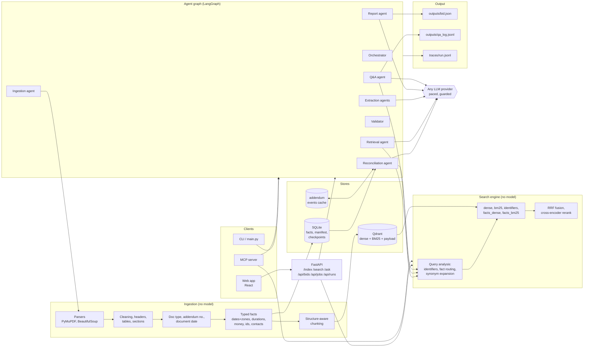
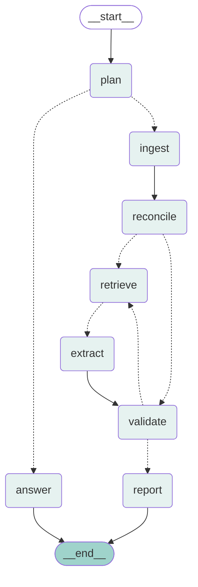

# Architecture

Two deterministic layers (ingestion with the fact layer, then the hybrid index) do as much of
the work as possible without a model. The agents on top use the search engine as their tool,
choose among typed candidates and cited passages, and everything they produce is checked by
code before it is written out.

## System

## Agent graph

Generated from the compiled graph with `uv run rfp diagram` (source in
[agent_graph.mmd](agent_graph.mmd)). Dotted edges are decisions: `plan` routes a question to
`answer` and a bid to `ingest`; `reconcile` fans out one `retrieve` branch per batch of fields
(with `Send`, so batches run in parallel); each `retrieve` hands its task and evidence to its
own `extract` (with `Command(goto=Send(...))`); `validate` sends each rejected field back to
`retrieve` with the reason (at most `RFP_MAX_RETRIES` times), or moves on to `report`.

## One extraction run, step by step

1. **plan** (orchestrator) reads the goal. For a bid it writes the plan: ingest, reconcile,
   one retrieve-and-extract step per batch of fields, validate, report. For a question, one
   step: answer.
2. **ingest** indexes the folder incrementally (files whose hash and embedding model match
   the manifest are skipped; new or changed files are parsed, chunked, embedded and their
   facts stored) and lists the documents with type, addendum number, date and pages.
3. **reconcile** loads the bid's facts. Deadline and pre-bid facts inside addenda become
   `replace` events with no model. For each addendum, the search engine is queried inside
   that document for change language and for each field an addendum can change; one
   structured call over those passages lists the other changes (new requirements,
   amendments, clarifications); events whose quote is not verbatim addendum text are
   dropped; the result is cached per document. The date fields are resolved by folding the
   events over the base documents, with the portal page used to fill a missing time and to
   corroborate.
4. **retrieve** (one branch per batch, in parallel): per field, search the field's name and
   queries, search again within the field's preferred document types, add every chunk holding
   a labelled fact, rerank the pool with the cross-encoder. On a retry, a cheap model first
   rewrites the queries from the validator's reason.
5. **extract** (one per batch): fit the passages to the prompt budget, then one structured
   call returns a draft per field (status, value, verbatim quotes with passage ids, notes).
   Fields with no evidence at all skip the model. A failed call marks the batch's drafts with
   the error instead of raising.
6. **validate**: every quote must be a substring of its passage, the value must follow from
   the quotes by field type, "not found" needs at least three searches and no labelled facts,
   and the model call must have succeeded. A failure goes back to step 4 with its reason.
7. **report**: text and list events are applied to the reconcilable fields, each field gets
   its confidence tier, the cross-field checks run (pre-bid before due date, addenda dated
   before the due date, due date after issue, delivery after due date), the summary is written
   and checked for sentence count and invented numbers, and the JSON is written with the
   change log, validation tally, usage and any errors.

Every node is a span under the run's root span, with its input and output; every model call
records its prompt, response, tokens, cost and error. `uv run rfp trace <run_id>` renders the
span file; the web app's Runs page shows it as a waterfall.

## Where the brief's requirements live

| Requirement | Where |
|---|---|
| Parsing, cleaning, metadata, failure log | `ingestion/` |
| Chunking with structure and overlap | `search/chunking.py` |
| Embeddings, vector store with metadata | `search/embed.py`, `search/backend.py` |
| Incremental indexing | `search/manifest.py`, `search/indexer.py` |
| Hybrid retrieval, filters, rerank, query rewriting | `search/engine.py`, `search/query.py`, `config/synonyms.yaml` |
| Retrieval eval, two or more configurations | `eval/retrieval_gold.yaml`, `eval/retrieval.py`, `docs/eval/retrieval.md` |
| REST API, CLI, web UI | `api/`, `cli.py`, `main.py`, `web/` |
| Orchestrator, plan, routing extract vs ask | `agents/nodes/orchestrator.py`, `agents/graph.py` |
| Retrieval agent: rewriting, filters, rerank | `agents/nodes/retrieve.py`, `agents/evidence.py` |
| Extraction specialists, parallel | `agents/nodes/extract.py`, `config/fields.yaml` (groups) |
| Addendum reconciliation | `agents/nodes/reconcile.py`, `agents/addenda.py`, `agents/reconcile.py` |
| Validator, feedback loop with a retry limit | `agents/nodes/validate.py`, `agents/validate.py`, `agents/consistency.py` |
| Q&A and report | `agents/nodes/answer.py`, `agents/qa.py`, `agents/nodes/report.py`, `agents/assemble.py` |
| Shared state | `agents/state.py` |
| Structured agent messages | `agents/state.py`, `agents/outputs.py`, `agents/schema.py` |
| Guardrails: citations, not found | `agents/validate.py`, `agents/qa.py`, `agents/assemble.py` |
| Observability | `telemetry.py`, `agents/guarded.py`, `trace_render.py`, web Runs page |
| Error handling | `agents/guarded.py`, `agents/providers.py` (retry-after), `agents/ratelimit.py`, `ingestion/loader.py` |
| Keys and model names from config | `config.py`, `config/defaults.env`, `.env.example` |
| 20 fields with sources, confidence, notes | `config/fields.yaml`, `agents/confidence.py`, `agents/schema.py` |
| Extraction accuracy and calibration | `eval/extraction_gold.yaml`, `eval/extraction.py`, `docs/eval/extraction.md` |
| Bonus: web UI | `web/` (React): bids, record, search, ask, compare, runs and traces |
| Bonus: OCR for scans and image tables | `ingestion/ocr.py`, `ingestion/pdf.py` (`_ocr_scanned_pages`, `_layout_tables`) |
| Bonus: bid comparison agent | `agents/compare.py`, `rfp compare`, `GET /api/compare`, `docs/comparison.md` |
| Bonus: go / no-go | `agents/gonogo.py`, `config/company.yaml`, `rfp go-no-go`, `GET /api/bids/{id}/go-no-go` |
| Bonus: semantic cache, cost and latency per run | `agents/qa_cache.py`; `usage` on every record, answer and span |
| Bonus: Docker, CI with tests and retrieval eval | `Dockerfile`, `docker-compose.yml`, `.github/workflows/ci.yml` |
